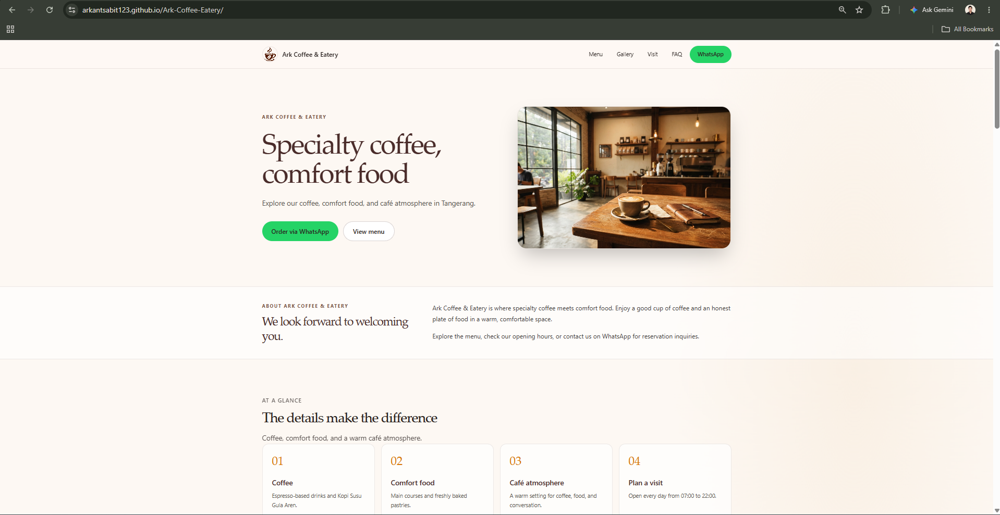
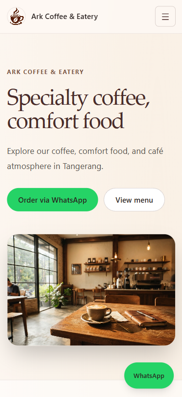
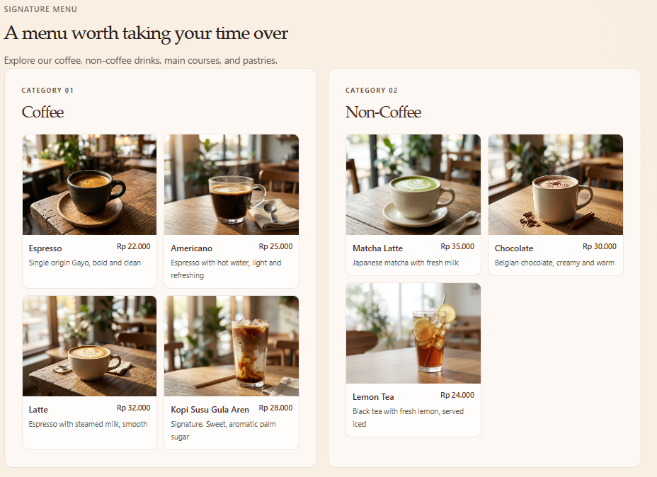
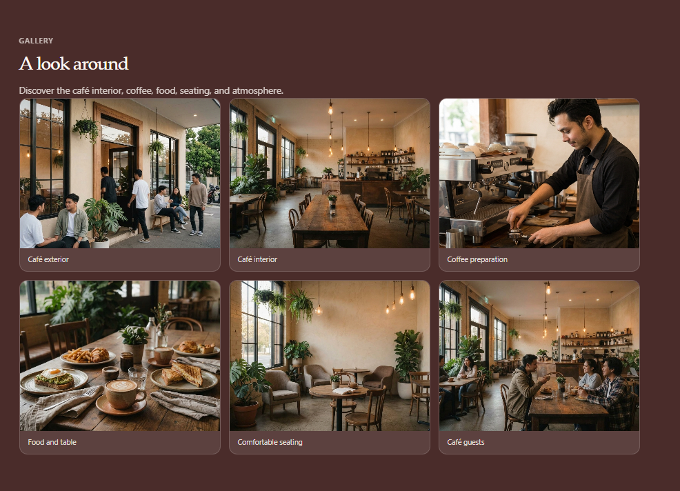
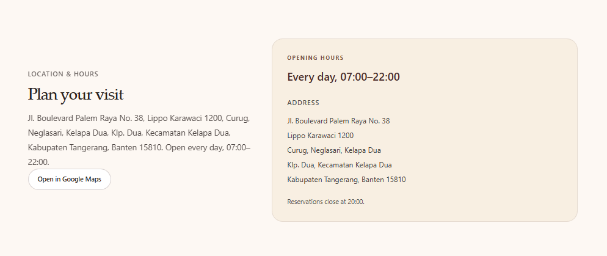
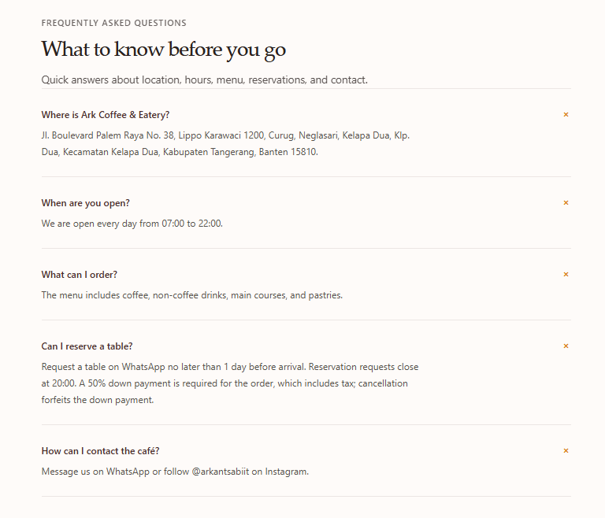
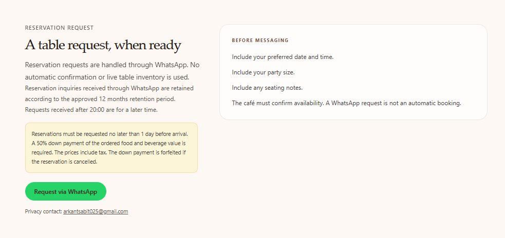

<h1 align="center">Ark Coffee &amp; Eatery</h1>

<p align="center">
  A warm, responsive, static Astro website for specialty coffee and comfort food.
</p>

<p align="center">
  
  <a target="_blank" href="https://astro.build/">
    
  </a>
  <a target="_blank" href="https://tailwindcss.com/">
    
  </a>
  <a href="./LICENSE">
    
  </a>
</p>

> **Live preview:** [https://arkantsabit123.github.io/Ark-Coffee-Eatery/](https://arkantsabit123.github.io/Ark-Coffee-Eatery/)

## Website Preview

<table>
  <tr>
    <td align="center" width="50%">
      
      <b>Desktop Home</b><br/>
      Full-width hero layout with approved navigation, heading, WhatsApp CTA, menu CTA, and hero image.
    </td>
    <td align="center" width="50%">
      
      <b>Mobile Home</b><br/>
      Mobile-first hero layout with the hamburger menu and touch-friendly actions.
    </td>
  </tr>
  <tr>
    <td align="center" width="50%">
      
      <b>Menu</b><br/>
      14 approved items across coffee, non-coffee, main course, and pastry categories.
    </td>
    <td align="center" width="50%">
      
      <b>Gallery</b><br/>
      Six visual slots for exterior, interior, coffee preparation, food, seating, and guests.
    </td>
  </tr>
  <tr>
    <td align="center" width="50%">
      
      <b>Location &amp; Hours</b><br/>
      Approved Tangerang address, opening hours, and Google Maps action.
    </td>
    <td align="center" width="50%">
      
      <b>FAQ</b><br/>
      Address, opening hours, menu, reservation, and contact answers.
    </td>
  </tr>
  <tr>
    <td align="center" colspan="2">
      
      <b>Reservation &amp; WhatsApp</b><br/>
      WhatsApp reservation guidance with the 1-day deadline, required pre-order, full payment, and cancellation policy.
    </td>
  </tr>
</table>

## Key Features

- 11 responsive page sections
- 14-item data-driven menu
- Six-item gallery
- WhatsApp-first conversion
- Accessible mobile navigation
- FAQ accordion
- Google Maps directions
- LocalBusiness structured data
- GitHub Pages static hosting with manual WhatsApp reservations; no online payment processing or reservation database
- Development-only reservation simulator with temporary in-memory data and no real payments
- Mobile sticky WhatsApp button
- 404 page

## Technology

- Astro `7.4.12`
- Tailwind CSS `4.3.5`
- TypeScript `6.0.2`
- Static Astro output
- Node.js `>=22.23.4`

## Local Setup

### Requirements

- Node.js `>=22.23.4`
- npm `>=9.6.5`

### Run the Static Website Locally

```powershell
npm install
npm run dev
```

Open `http://localhost:4321/Ark-Coffee-Eatery/` (the project uses `/Ark-Coffee-Eatery/` as its base path).

In development mode, the reservation section includes a local-only prototype. To use its in-memory API, start a second terminal and run:

```powershell
npm run dev:reservation-api
```

Use synthetic test details only. The local API binds to `127.0.0.1`, has no authentication or durable storage, sends no WhatsApp messages, and does not transfer or refund money. Restarting it clears its demo reservations. The production static build excludes the prototype.

To test the API workflows from a third terminal, with Python 3 installed and the local API running, use:

```powershell
python scripts\test_local_reservation.py
```

The script uses Python's standard library and creates two synthetic reservations in memory: one approval and one rejection/refund simulation. It only calls `127.0.0.1:8787`; it does not send messages or move money. Each run creates new demo entries; restart the API to clear them.

### Validate and Preview

```powershell
npm run check
npm run build
npm run test
npm run preview
```

`npm run test` reads the generated `dist/index.html`, so run `npm run build` first.

## Image Assets

The image directory is organized as follows:

```text
public/
├── favicon.jpg
└── images/
    ├── hero/hero-cafe.jpg
    ├── menu/
    │   ├── coffee/
    │   ├── non-coffee/
    │   ├── main-course/
    │   └── pastry/
    └── gallery/
```

Image descriptions and replacement guidance are maintained in [docs/design-system.md](./docs/design-system.md).

## Project Status

| Area | Status |
|---|---|
| Responsive frontend | Implemented |
| Approved business facts | Implemented |
| 14-item menu | Implemented |
| WhatsApp interactions | Implemented |
| Reservation backend | Local in-memory simulator only; no production database |
| Online payments | Not connected; transfer/e-wallet verification and refunds remain manual |
| Analytics | Not active |
| GitHub Pages deployment | Workflow included; repository Pages setting required |
| Production domain | Not required for initial GitHub Pages release |
| Canonical URL | GitHub Pages project URL configured |
| Production smoke test | Pending after deployment |

## Documentation

- [Project specification](./docs/README.md)
- [Architecture decisions](./docs/architecture-decisions.md)
- [Blueprint](./docs/blueprint.md)
- [Design system](./docs/design-system.md)
- [Content guide](./docs/content-guide.md)
- [Deployment guide](./docs/deployment-guide.md)
- [Test plan](./docs/test-plan.md)
- [Verification checklist](./docs/verification-checklist.md)
- [Operations runbook](./docs/operations-runbook.md)
- [Customer package overview](./docs/customer-package.md)

## License

See [LICENSE](./LICENSE).
